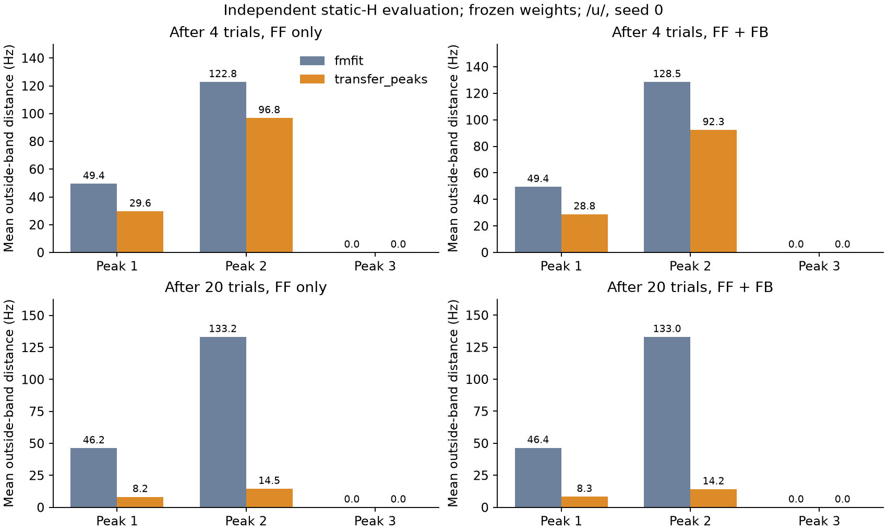

# TRANSFER-PEAK-01 固定比較結果

2026-10-23。[実装前Issue](https://github.com/imo1-nu/stutter_tts_jp/issues/34)、[事前条件](../../TRANSFER_PEAK_PROTOCOL.md)、[使用方法](../../TRANSFER_PEAK_USAGE.md)。

## 仮説

同じ調音状態の静的Hピークで聴覚誤差を計算すると、従来fmfit観測よりHピークの目標帯外距離が減る可能性。既存逆写像との不一致、体性感覚との競合、姿勢補正、ピーク順位切替も競合説明として残す。

## 実装

実状態観測のF1–F3のみを変更。既定fmfit、F0、体性感覚8成分、目標、逆写像・姿勢補正、音源・波形合成式は保持。別インスタンスで幾何を評価し、値・マスク・時刻・理由を同じ10ステップ遅延へ渡す。欠測は0の輸送値とfalseマスクで表し、聴覚誤差を0にしてから従来の補正・学習へ渡す。401点初期バッファの既知失敗は再現し、PR #1相当の互換修正を独立コミット00268e7へ分離した。

## 方法

同じ既存/u/401点目標・ゼロFF・seed0、FFゲイン.85、FBゲイン.30（内部.5）、学習EPS=.5で20回。4回・20回後の重みを保存し、毎回同一初期内部状態から学習停止のFF-only / FF+FB生成を行った。固定評価8件すべてで重み完全不変を確認。全411フレームを保存し、主評価は.5≤t<1.5秒の200点。

主評価Hは観測関数を呼ばず、raw→独立NumPy輪郭→xy2ab式→面積処理→H式で再計算。MATLAB式の転記でありMATLAB実行ではない。同じ定義のH最大値の参照で、人体の独立実測ではない。fs11025 Hz、65536点、prominence1 dB、間隔50 Hz、50–4950 Hz、周波数順先頭3本を固定。目標はF1=306.56–431.71、F2=1155.02–1771.98、F3=2301.46–2732.63 Hz（丸め表示）。

## 結果：固定重み生成

帯内率・有効率の分母は欠測を含む全予定観測。表は厳密な帯内率で、保存コードの数値許容差.1 Hzによる率もJSONに併記。距離は有効点平均なので、有効率低下を伴う場合は単独で改善判定に使わない。体性SSEは8成分の帯外距離二乗和の時間平均。

|観測|学習回数|生成|ピーク1/2/3 平均帯外Hz|3成分平均Hz|有効率|全3成分同時帯内率|体性SSE|
|---|---:|---|---|---:|---:|---:|---:|
|fmfit|4|ff_only|49.426 / 122.778 / 0.000|57.401|100.0%|0.0%|0.045454|
|fmfit|4|ff_fb|49.426 / 128.498 / 0.000|59.308|100.0%|0.0%|0.036601|
|fmfit|20|ff_only|46.230 / 133.209 / 0.000|59.813|100.0%|0.0%|0.003086|
|fmfit|20|ff_fb|46.398 / 133.040 / 0.000|59.813|100.0%|0.0%|0.003088|
|transfer_peaks|4|ff_only|29.575 / 96.828 / 0.000|42.135|100.0%|0.0%|0.048157|
|transfer_peaks|4|ff_fb|28.784 / 92.300 / 0.000|40.361|100.0%|0.0%|0.039322|
|transfer_peaks|20|ff_only|8.194 / 14.539 / 0.000|7.578|100.0%|0.0%|0.002491|
|transfer_peaks|20|ff_fb|8.307 / 14.180 / 0.000|7.495|100.0%|0.0%|0.002473|

### 新モード − fmfit（負は距離減少）

|学習回数|生成|ピーク1/2/3 ΔHz|全成分平均 ΔHz|体性SSE Δ|
|---:|---|---|---:|---:|
|4|ff_only|-19.851 / -25.950 / +0.000|-15.267|+0.002704|
|4|ff_fb|-20.642 / -36.198 / +0.000|-18.947|+0.002721|
|20|ff_only|-38.036 / -118.670 / +0.000|-52.235|-0.000595|
|20|ff_fb|-38.091 / -118.861 / +0.000|-52.317|-0.000615|

## 測定不能・処理時間

- fmfit: 学習20回の平均測定不能率 0.00%、固定評価有効率 100.0%–100.0%。学習1試行平均 17.27秒。H観測1回の固定評価平均 33.41 ms、最大 39.36 ms。
- transfer_peaks: 学習20回の平均測定不能率 0.00%、固定評価有効率 100.0%–100.0%。学習1試行平均 17.40秒。H観測1回の固定評価平均 32.51 ms、最大 36.61 ms。

有効率は主評価窓の静的H観測についての値である。新モードの遅延バッファ先頭10点はF1–F3無効で、学習・評価ともその初期マスクを保持し、全411点のログにも残した。

fmfit条件にも保存用の診断H計算を追加したため、上の試行時間を通常fmfit単体の速度とは解釈しない。静的Hの計算負荷は5 ms刻みの実時間動作を保証しない。周波数格子長を観測窓や追加遅延と解釈しない。

## 検証

- 固定テスト40状態と保存NPZの独立H再抽出40状態：最大差0 Hz（1 Hz条件を満たす）。
- main2920c35参照の4回：感覚・運動・FF/FB指令・誤差・FF更新が全要素完全一致。参照にはCPU置換と明示的初回ゼロパディングのみ。
- 固定評価8系列の独立再計算との最大差は0.673 Hz以下、有効性の不一致0。
- 11テスト成功。新観測→非ゼロの聴覚誤差→fmfit逆写像、NullSpaceGainのfmfit維持、Scale/tanh一回、F0/体性感覚、閉鎖・空・非有限H・不足・リセット・マスク遅延、乱数/合成状態を検証。
- 全保存系列で値・マスクの10ステップ対応と無効誤差0、EPS=.5の全FF更新の再構成を検算。source/assets/inputの前後SHA不変。
- 既存xy2abのcenter02ではAll-NaN axis警告が残る。40状態の採用面積・H・ピークは有限で、警告を成功の代わりに扱っていない。

## 解釈と限界

今回の固定条件では4回・20回後のFF-only/FF+FBすべてでHピークの平均帯外距離が減少した。20回後は3成分平均がFF-onlyで59.813→7.578 Hz、FF+FBで59.813→7.495 Hzとなり、仮説をこの限定条件で支持する。有効率は全条件100%で、欠測増加による見かけの改善ではない。一方、第1・第2ピークは全中央窓で厳密には帯外のままで、全3成分同時帯内率は全条件0%。目標達成とは判定しない。第3ピークは両モードとも帯内だった。体性SSEは4回後に新モードで増加（約.0027）、20回後には減少（約.0006）した。

この差は固定した観測経路の効果であり、制御へ返した同じ値を再表示しただけの判定ではない。独立式による固定評価8系列の全raw状態の再評価と、別に生成したFF-only結果を含めて比較した。成分間の悪化、体性誤差、有効率を併記し、学習中の信号を固定評価へ混在させない。単一/u/・seed0・既存目標・既存inverseに限定する。競合説明の個別アブレーションは行っておらず、原因を一つに確定しない。波形推定・極周波数・知覚品質を評価していないため、波形一致、自然性、日本語母音の達成へ拡張しない。

## 保存と再現

[全8条件JSON](evaluations.json)、[CSV](evaluations.csv)、[条件差](contrasts.json)、[オンライン学習ログ](learning.json)、[コード・入力・資産・環境来歴](provenance.json)、[main回帰と全系列検算](validation.json)、[40状態独立H照合](reference_check.json)、[実行時テスト](tests.txt)、[最終ソース11テスト](final_tests.txt)。

全NPZ・raw・重み・マスク/理由/時刻・FF/FB・エラー・入力コピー・ソーススナップショットは専用worktreeの`outputs/transfer_peak01/`へ保存（大きな元データはGit追跡外）。[実行スクリプト](../../../../experiments/run_transfer_peak_feedback.py)、[独立参照](../../../../experiments/transfer_peak_reference.py)、[保存系列検算](../../../../experiments/validate_transfer_peak_run.py)、[集計/図](../../../../experiments/report_transfer_peak_feedback.py)。

比較条件を結果に合わせて変更していない。追加した厳密帯内率は保存済みの.1 Hz許容差率を残して併記し、全8条件へ一律適用した集計上の明示である。

## コード・保存場所の補足

数値実行のcoreは736878c（srcの各SHAはprovenance.json）。実行後に既存ランタイムに不要なPython3.10要件を追加しないため、`PeakMeasurement | None`という型注釈を`Optional[PeakMeasurement]`へ変更した。数値式・観測・マスク・制御・比較条件は同一で、最終ソースの11テストも通過した。数値実行時のソースはローカルoutputsのsources/feature/srcに別保存した。検証スクリプト・結果集計・記述の追記は制御実装から分離して来歴を保持する。

実行中のworktreeと出力は/tmp下に隔離し、実行終了後に`.worktrees/transfer-peak-feedback/`へ移した。元の/tmpパスを含む実行来歴は書き換えず、移動対応をローカルoutputsのrelocation.jsonに記録した。実行環境のuv.lock/pyprojectとソーススナップショットも保存している。Python3.7での実行検証はしておらず、実際の検証環境はPython3.12.3である。
